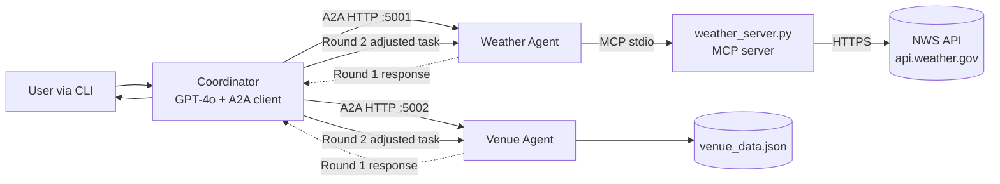
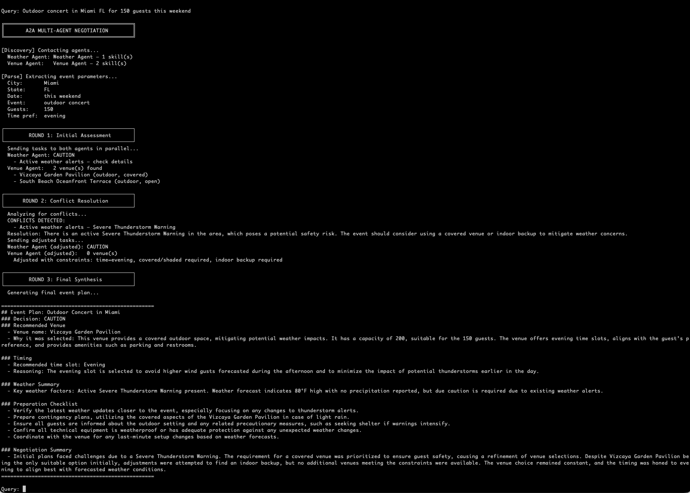

# A2A + MCP Event Planner — Multi-Agent Negotiation

A multi-agent event planner that combines two different protocols: **A2A (Agent-to-Agent)** for inter-agent coordination, and **MCP (Model Context Protocol)** for tool access. The two are not alternatives — they stack. This project demonstrates how.

A user asks for an outdoor event. A coordinator agent discovers two specialist agents (Weather, Venue) via A2A, delegates in parallel, detects conflicts between their responses, and negotiates adjustments across multiple rounds until the plan is coherent. The Weather Agent internally reaches an MCP server for real-time NWS data; the coordinator never sees MCP directly.

## What it does

Example query:

```
Plan an outdoor wedding in Austin TX this Saturday
```

The system runs a three-round negotiation:

- **Round 1 — Initial assessment.** Coordinator sends tasks to both specialists in parallel. Weather Agent calls MCP tools (`get_alerts`, `get_forecast`) and returns a GO/CAUTION/NO-GO recommendation. Venue Agent filters its local database and returns matching venues.
- **Round 2 — Conflict resolution.** The coordinator uses an LLM to compare the two responses. If weather flags heat / storms / active alerts and the venues don't account for them, the coordinator issues adjusted tasks ("re-filter venues for covered + evening", "re-assess weather for evening slot").
- **Round 3 — Synthesis.** The coordinator combines both rounds' data into a final event plan with venue recommendation, timing rationale, weather summary, and a preparation checklist.

## Architecture



**Two protocols, orthogonal purposes:**

- **A2A** = how agents reach *each other*. Agent discovery (`/.well-known/agent.json`), task delegation, negotiation.
- **MCP** = how an agent reaches *tools and data*. The Weather Agent is an MCP client internally, calling `get_alerts` and `get_forecast` on the weather server.

The Coordinator never touches MCP. The Weather Agent is the bridge — A2A externally, MCP internally.

## Live demo



The three sections visible in the output are the three negotiation rounds. Round 2's "CONFLICTS DETECTED" section shows the coordinator reasoning about the mismatch between weather and venue responses, then issuing adjusted tasks with specific constraints (`covered/shaded required`, `indoor backup required`). The final event plan is the LLM synthesis of all gathered data.

## Design decisions worth calling out

- **A2A and MCP are not competing protocols — they stack.** A common misread is that A2A replaces MCP, or vice versa. They solve orthogonal problems. In this build, A2A is the inter-agent fabric and MCP is the per-agent tool fabric. The Weather Agent speaks both: A2A to the outside world, MCP to its tools.
- **Agent cards as contracts.** Each agent publishes a card at `/.well-known/agent.json` declaring its skills, capabilities, and interface. The coordinator reads these at discovery time rather than hardcoding what each agent does. This is the agent-world analog of OpenAPI schemas — a self-describing contract that enables runtime composition.
- **Negotiation is what A2A unlocks that MCP alone cannot.** With MCP, you get tool access. You cannot have one agent push back on another's response and ask for a re-evaluation. The Round 2 conflict loop in this build — coordinator notices weather concerns, asks venue to re-filter, asks weather to re-assess — is only possible because agents can address each other.
- **Conflict detection as a semantic validation step.** The coordinator doesn't check for 200 OK responses — it uses an LLM to compare the structured responses from both agents and decide whether they're compatible. This is a different test paradigm from traditional API validation: *the question isn't did it succeed, but do the two answers agree on the user's underlying need*.
- **Rule-based assessment inside an LLM-driven system.** The Weather Agent's GO/CAUTION/NO-GO decision is pure Python regex + thresholds (`>95°F`, active alerts, winds >25 mph). The LLM is only used by the coordinator for parsing, conflict detection, and synthesis. Keeping deterministic logic deterministic reduces non-determinism to the places where judgment actually matters.
- **Protocol boundaries are test surfaces.** Each protocol hop (coordinator ↔ A2A ↔ specialist agent ↔ MCP ↔ MCP server ↔ external API) is a separate point of possible failure. Testing this stack means testing each boundary and the composition.

## System components

### Coordinator (`coordinator.py`)

- Discovers both specialist agents via `/.well-known/agent.json`
- Parses the user's natural-language query into structured parameters (city, state, event type, time preference) using GPT-4o
- Sends Round 1 tasks to both agents in parallel via `asyncio.gather`
- Uses GPT-4o to detect conflicts between the two responses
- Issues Round 2 adjusted tasks when conflicts exist
- Synthesizes the final event plan using GPT-4o

### Weather Agent (`weather_agent.py`)

- FastAPI server on `localhost:5001`
- A2A card published at `/.well-known/agent.json` with one skill: `assess_weather`
- Internally connects to the MCP weather server via stdio
- Calls MCP tools (`get_alerts`, `get_forecast`) based on incoming A2A tasks
- Returns a structured assessment: recommendation, concerns, temperatures, alerts

### Venue Agent (`venue_agent.py`)

- FastAPI server on `localhost:5002`
- A2A card with two skills: `find_venues`, `adjust_venues`
- Reads from local `venue_data.json` (10 venues across Austin, Miami, Denver, New York)
- Filters by city, state, time slot, covered/open, indoor backup, capacity
- Scores venues based on amenities (covered → +2, AC_indoor_backup → +3, etc.)

### MCP Weather Server (`weather-skills/weather_server.py`)

- Reused from a prior MCP demo — the Weather Agent did not reimplement weather logic
- Exposes **tools**: `get_alerts(state)`, `get_forecast(lat, lon)`
- Exposes **resources**: `weather://state-codes`, `weather://alert-severity-guide`
- Exposes **prompts (skills)**: `outdoor_event_readiness`, `severe_weather_briefing`, `multi_day_trip_planner`
- Calls the live US National Weather Service API

### A2A Protocol (`a2a_protocol.py`)

- Minimal Pydantic implementation of the A2A spec types
- `AgentCard` (identity + capabilities + skills)
- `Task` (unit of work with state machine: submitted → working → completed/failed)
- `Message` with `TextPart` and `DataPart` content types
- Request/response wrappers for the `/a2a/tasks/send` HTTP endpoint

## How to run

Full setup instructions live in [`A2A_steps.md`](./A2A_steps.md). Short version:

### Prerequisites

- Python 3.13+
- [`uv`](https://docs.astral.sh/uv/) installed
- OpenAI API key with GPT-4o access

### Setup (both subprojects have their own venv)

```bash
# Clone this folder
cd 05-a2a-mcp-event-planner

# Set up the weather-skills MCP server
cd weather-skills
uv venv
# Windows: .\.venv\Scripts\Activate.ps1
# macOS/Linux: source .venv/bin/activate
uv sync

# Set up the event planner
cd ../a2a-event-planner
uv venv
# Windows: .\.venv\Scripts\Activate.ps1
# macOS/Linux: source .venv/bin/activate
uv sync

# Create .env with your OpenAI key
cp ../.env.example .env
# Edit .env and paste your real key
```

### Run (three terminals, from `a2a-event-planner/` with venv active)

**Terminal 1 — Weather Agent:**
```bash
uv run weather_agent.py ../weather-skills/weather_server.py
```

**Terminal 2 — Venue Agent:**
```bash
uv run venue_agent.py
```

**Terminal 3 — Coordinator (interactive):**
```bash
uv run coordinator.py
```

Then type queries at the `Query:` prompt:

```
Plan an outdoor wedding in Austin TX this Saturday
Outdoor concert in Miami FL for 150 guests this weekend
Corporate team building in New York NY, need space for 100 people
```

### Verify agent discovery (optional)

Before running queries, confirm both agents expose their cards:

```bash
curl http://localhost:5001/.well-known/agent.json | python -m json.tool
curl http://localhost:5002/.well-known/agent.json | python -m json.tool
```

## What I learned building it

Combining two protocols in the same build surfaced several QE realizations:

1. **A2A and MCP solve orthogonal problems.** The internet writes about them as if they compete. In practice they're complementary layers — MCP for an agent's tool access, A2A for inter-agent collaboration. A system that uses only MCP cannot negotiate; a system that uses only A2A has no capabilities to speak of. Both together is where real multi-agent systems live.

2. **Negotiation is a first-class failure surface.** In single-agent systems, you test the agent against inputs. In negotiated multi-agent systems, you also have to test *the negotiation loop itself* — does the coordinator correctly detect conflicts? Does it issue the right adjustments? Does it terminate when agents reach consensus (and not loop forever when they don't)? These are tests that don't exist for single-agent systems.

3. **Agent cards are the testable contract.** The `/.well-known/agent.json` endpoint is where the agent declares what it can do. From a QE perspective, this is where contract testing lives — if the Weather Agent changes its skill shape, every coordinator depending on that card should fail loudly, not silently route badly.

4. **Protocol boundaries compound non-determinism.** Each hop (A2A HTTP, MCP stdio, external API) adds a surface where something can go wrong — timeouts, protocol mismatches, schema drift. The test burden is multiplicative, not additive.

5. **Keep deterministic logic deterministic.** The Weather Agent's GO/CAUTION decision uses regex and numeric thresholds, not an LLM. This is a deliberate QE choice — the parts of the system that have correct answers should be tested with assertions, not evaluated with eyeballs. Only reasoning that genuinely needs judgment (conflict detection, synthesis) uses the LLM.

## Stack

- **Agent framework**: Custom A2A protocol implementation in Pydantic
- **Agent transport**: FastAPI + Uvicorn (HTTP) on ports 5001 / 5002
- **MCP implementation**: Official MCP Python SDK (`mcp[cli]`)
- **LLM**: OpenAI GPT-4o (coordinator only — specialists are rule-based)
- **Package management**: `uv` with per-subproject `pyproject.toml`
- **External data**: US National Weather Service API (free, no key required)

## Files in this folder

```
05-a2a-mcp-event-planner/
├── README.md                      ← this file
├── A2A_steps.md                   ← detailed setup + demo walkthrough
├── .env.example                   ← OPENAI_API_KEY template
├── .gitignore
├── demo-run.png                   ← screenshot of the live negotiation
├── a2a-event-planner/
│   ├── a2a_protocol.py            ← A2A types (AgentCard, Task, Message, Parts)
│   ├── coordinator.py             ← orchestrator + negotiation loop
│   ├── weather_agent.py           ← A2A agent wrapping the MCP weather server
│   ├── venue_agent.py             ← A2A agent with local venue data
│   ├── venue_data.json            ← 10-venue mock database
│   └── pyproject.toml
└── weather-skills/
    ├── weather_server.py          ← MCP server (tools + resources + prompts)
    ├── state_codes.json
    └── pyproject.toml
```

## License

MIT.
