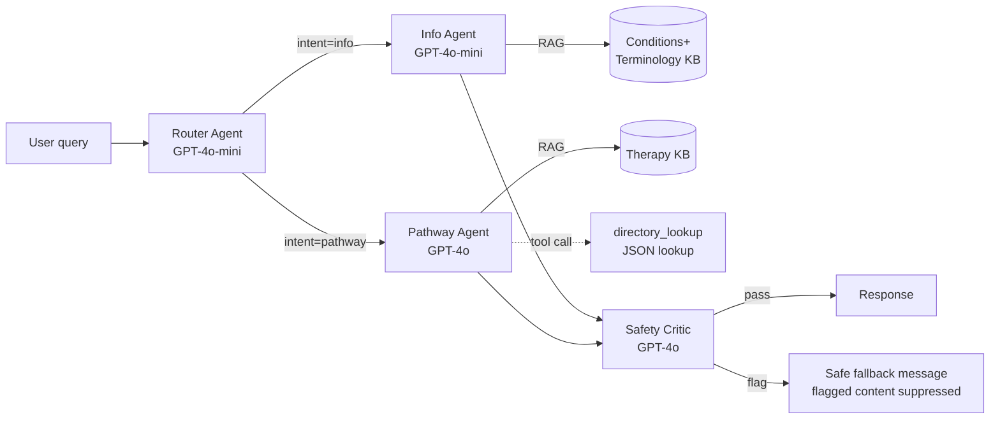
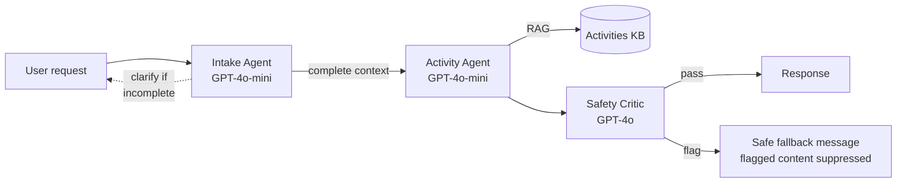

# NorthStar — Strategy & Architecture

**Capstone Exercise ** · Execution strategy, agent architecture, orchestration patterns, evaluation plan, and future-state roadmap.

**[Demo video](https://drive.google.com/file/d/1KSxrxj2WXw-xuPySGRgvOnTfTl3LHSPM/view?usp=sharing)**

> **Two build phases.** Sections 1–15 are the original 7-day MVP. Sections 16–18 are a second
> pass, built after an instructor review session surfaced gaps (persistent child data, login,
> consent, conversation memory, live correctness judging, human-in-the-loop review) — see
> `BUILD_LOG.md` for the day-by-day record of both phases.

---

## 1. Problem statement

Parents of neurodivergent children face a brutal information gap: terminology they can't parse, therapy categories they've never heard of, therapist directories scattered across cities, and no trustworthy single place to understand their child's condition without being either overwhelmed by clinical jargon or misled by confidently-wrong AI chatbots. NorthStar is a navigator — not a clinician — designed to close that gap while deferring every medical decision to qualified specialists.

## 2. Users and personas

**Primary user: Newly-diagnosed parent (Priya)**

- 32–45 year old parent, English-literate, India-based
- Child recently diagnosed with autism, ADHD, apraxia, or a rare neurodevelopmental condition
- Needs: understand the condition, understand the terminology, find qualified help, help the child in daily moments
- Pain: fragmented information, clinical jargon, time-poor, emotionally stretched

**Secondary user: Caregiver mid-journey (Rajesh)**

- Has been navigating a child's condition for 1–3 years
- Needs: specific activity ideas, therapy categories to explore for new challenges, local specialist leads
- Pain: knows the basics, needs depth and daily tactics

## 3. Scope decision — what we build in 1 week vs defer

**MVP (Week 1 — built end-to-end):**

- 2 workflows (Ask NorthStar, Daily Support)
- 5 specialist agents + 1 external tool + shared Safety Critic
- 3 knowledge bases (Conditions+Terminology, Therapy, Activities)
- Fictional therapist directory (10–20 entries across 3–4 Indian cities)
- Streamlit UI with chat, sidebar context, observability panel, feedback capture
- LangSmith tracing + online feedback eval
- DeepEval offline eval on golden set of ~20 queries
- One demonstrated v1→v2 improvement cycle with measurable score delta

**Deferred to future state (documented, not built):**

- Specialist therapist persona agents (OT / Speech / Behavioral — each with own prompt + deeper RAG)
- Event aggregator (online + local events)
- Parent community / support group
- Voice chat interface (STT + TTS)
- Multi-language support (Hindi, regional languages)
- Verified real-world therapist directory with credentials and ratings
- Mobile-optimized interface
- Peer / professional review workflow

The MVP is deliberately the leanest shape that still hits every capstone rubric item. Future-state items are listed in Section 11.

## 4. The non-negotiable design principle

**NorthStar is a navigator, not a clinician.** Encoded as four engineering constraints:

1. **No diagnostic language.** The system never says what a child "has" based on symptoms.
2. **No treatment prescription.** The system suggests therapy _categories_ commonly discussed for a condition, never specific treatment plans.
3. **Always refer to qualified specialists.** Every therapy-adjacent response ends with a professional-referral disclaimer.
4. **Out-of-scope refusal.** When the KB doesn't cover a question, the system says so rather than guessing.

The Safety Critic agent enforces all four constraints on every output.

## 5. Architecture overview — four pillars


**Four pillars (Phase 1 — the original MVP):**

1. **Ask NorthStar workflow** — synchronous Q&A with router + specialists
2. **Daily Support workflow** — contextual activity suggestions per session
3. **Safety Critic layer** — shared quality gate across both workflows
4. **Feedback-driven improvement loop** — closes the LLMOps cycle

**Wrapping these, a Phase 2 persistence & trust layer** (sections 16–18): every parent logs in
and explicitly consents before anything is stored; their child profile, Ask NorthStar history,
and Daily Support outcomes persist across sessions instead of resetting per tab; Workflow 1 now
carries conversation context across a follow-up; and every Safety Critic verdict is recorded for
a minimal human-in-the-loop review queue. The four pillars above are unchanged by this — it
wraps them, not replaces them.

---

## 6. Workflow 1 — Ask NorthStar (detailed)

**Pattern:** Hub-and-Spoke (Router)

**User-facing purpose:** Answer parent questions about conditions, terminology, therapy categories, and specialist directories.



> **Note on the flag path:** this diagram originally planned a revision loop (flagged output sent back to the originating agent for a retry). That was never built — see section 9 below for what actually ships: the Critic's flag suppresses the response outright rather than retrying it, a deliberate scope decision made on Day 7 after live testing surfaced a real case of the Critic correctly flagging a fabricated response that was still reaching the parent unchanged.

### Agents

| Agent             | Role                                                                   | Model       | Grounding                            |
| ----------------- | ---------------------------------------------------------------------- | ----------- | ------------------------------------ |
| **Router**        | Classifies query intent (info / pathway / out-of-scope)                | GPT-4o-mini | Routing rubric in prompt             |
| **Info Agent**    | Explains conditions and terminology                                    | GPT-4o-mini | RAG from Conditions+Terminology KB   |
| **Pathway Agent** | Reasons about therapy categories; calls directory tool for specialists | GPT-4o      | RAG from Therapy KB + directory tool |
| **Safety Critic** | Gates every output                                                     | GPT-4o      | Rubric-based judgment                |

### Agent contracts (Pydantic schemas)

```python
class RouterOutput(BaseModel):
    intent: Literal["info", "pathway", "out_of_scope"]
    reasoning: str
    extracted_entities: dict  # e.g., {"condition": "autism", "city": "Bangalore"}

class InfoOutput(BaseModel):
    topic: str
    explanation: str  # grounded in retrieved chunks
    retrieved_chunks: list[str]  # for transparency
    source_ids: list[str]
    disclaimer: str

class PathwayOutput(BaseModel):
    condition: str
    recommended_therapy_categories: list[dict]  # {category, rationale}
    specialists_in_city: list[dict] | None  # populated if directory tool called
    retrieved_chunks: list[str]
    disclaimer: str  # mandatory professional-referral text

class SafetyCriticOutput(BaseModel):
    verdict: Literal["pass", "flag"]
    checks: dict  # {no_diagnosis, has_disclaimer, no_overpromise, in_scope, is_correct: bool}
    reason: str | None
```

> **Build note:** OpenAI's structured-output feature can't represent a fully open-ended `dict` —
> every field must be concretely typed. `extracted_entities` and `checks` above are `dict[str, str]`
> / `dict[str, bool]` in the actual code, and `IntakeOutput.clarifying_questions` (section 7) is a
> plain `list[str]` (empty rather than `None` when nothing's missing) for the same reason. Same
> shapes and intent as planned here, just concretely typed where OpenAI's API required it.

### The `directory_lookup` tool

```python
def directory_lookup(
    therapy_categories: list[str],
    city: str,
    limit: int = 5
) -> list[dict]:
    """Reads therapists.json, filters by category and city, returns matches."""
```

Called by the Pathway Agent when the parent asks about specialists. Returns structured entries with name, specialization, city, contact.

---

## 7. Workflow 2 — Daily Support (detailed)

**Pattern:** Sequential pipeline

**User-facing purpose:** Suggest age- and condition-appropriate activities for engagement or regulation, using the child context set earlier in the session.



> Same note as Workflow 1 above: flagged output is suppressed, not revised — see section 9.

### Agents

| Agent             | Role                                                                                                       | Model       | Grounding                            |
| ----------------- | ---------------------------------------------------------------------------------------------------------- | ----------- | ------------------------------------ |
| **Intake**        | Captures/confirms child's condition from session + current need; asks clarifying Qs if input is incomplete | GPT-4o-mini | Session state + conversation history |
| **Activity**      | Generates age- and condition-appropriate activities (engagement or regulation)                             | GPT-4o-mini | RAG from Activities KB               |
| **Safety Critic** | Same critic as Workflow 1 — shared                                                                         | GPT-4o      | Rubric-based judgment                |

### Agent contracts

```python
class IntakeOutput(BaseModel):
    condition: str
    age_range: str
    current_need: Literal["engagement", "regulation", "other"]
    clarifying_questions: list[str] | None  # non-empty if context is incomplete
    ready_for_activity_agent: bool

class ActivityOutput(BaseModel):
    activity_name: str
    materials_needed: list[str]
    steps: list[str]
    why_it_helps: str  # grounded in retrieved rationale
    duration_minutes: int
    retrieved_chunks: list[str]
    disclaimer: str
```

### Intake Agent's independent-action logic

If the parent sends _"suggest activities for my child"_ without having set child context yet, the Intake Agent:

1. Checks session state
2. Finds missing context (condition / age / current need)
3. Returns `clarifying_questions` to the UI instead of proceeding
4. UI asks the parent; parent answers
5. Intake re-runs with completed context
6. Only then does it hand off to the Activity Agent

This is the **Agent → Independent Action** pattern per the rubric.

---

## 8. Knowledge bases

Three self-built KBs. All stored as local JSON files for MVP (no vector DB — overkill for the scale). Retrieval uses simple semantic chunk matching with OpenAI embeddings.

### KB 1: Conditions + Terminology

5–6 conditions covered at launch:

- Autism Spectrum Disorder
- ADHD
- Apraxia / Childhood Apraxia of Speech
- Dyspraxia / Developmental Coordination Disorder
- Sensory Processing Disorder
- One rare neurodevelopmental syndrome (as a representative case for rare conditions)

Each condition entry contains:

- Overview (plain-language description)
- Common signs / presentation
- Related terminology (definitions inline)
- Related therapy categories (link to KB 2)
- Honest "what we don't cover" section

Terminology is interleaved per condition rather than kept separate — this matched the user's intuition that terminology is bound to the condition it belongs to.

### KB 2: Therapy

Covers therapy categories commonly discussed for the above conditions:

- Occupational Therapy
- Speech-Language Therapy
- Behavioral Therapy
- Physical Therapy
- Developmental Pediatrics (as the gateway specialty)

Each therapy entry contains:

- What the therapy addresses
- Which conditions it's commonly explored for (with rationale)
- Typical session format
- Honest limits (what the therapy does NOT do)

### KB 3: Activities

15–20 activities covering:

- Sensory regulation (calming / alerting)
- Engagement (play-based)
- Motor skill support
- Communication support
- Social skill scaffolding

Each activity entry contains:

- Name, age range, condition relevance
- Materials needed
- Step-by-step
- Why it helps (grounded rationale)
- Duration

### Directory (not a KB — a tool-accessible JSON file)

`therapists.json` with 15–20 fictional entries across 3–4 Indian cities. Fields: id, name, specialization, city, area, contact, note. Fictional at launch for safety; real listings on roadmap.

---

## 9. Guardrails — enforced by Safety Critic

Five non-negotiable checks on every output:

| Check                                         | Fail trigger                                                                                                                                                             | Action on fail (as actually built)                                     |
| --------------------------------------------- | ------------------------------------------------------------------------------------------------------------------------------------------------------------------------ | ---------------------------------------------------------------------- |
| **No diagnostic language**                    | Output contains phrases like "your child has X" or "based on these symptoms, this is Y"                                                                                  | Response suppressed; parent sees a fixed safe-fallback message instead |
| **Professional-referral disclaimer present**  | Therapy/activity response missing the "consult a qualified specialist" footer                                                                                            | Response suppressed; parent sees a fixed safe-fallback message instead |
| **No overpromising**                          | Output contains "will cure," "guaranteed," "always works," etc.                                                                                                          | Response suppressed; parent sees a fixed safe-fallback message instead |
| **In scope**                                  | Output answers a question the KB doesn't actually cover                                                                                                                  | Response suppressed; parent sees a fixed safe-fallback message instead |
| **Correct** (`is_correct`, added post-review) | Output misrepresents something that IS in the grounding context (e.g. swaps which category goes with which condition), or doesn't actually address what the parent asked | Response suppressed; parent sees a fixed safe-fallback message instead |

Any single check failing sets the overall verdict to `flag` (computed in code from the five booleans, never trusted from the Critic's own self-report — see `agents/safety_critic.py`), which suppresses the whole response uniformly rather than taking a different action per check. The flagged original content isn't discarded — it's kept and shown in the UI's "How did I arrive at this?" transparency panel, so a flag is demonstrable during a demo rather than silently invisible. A true per-check revision loop (the agent retrying with the specific failure as feedback) was the original plan but was cut for time; see the Phase 2 roadmap in section 14.

**Why `is_correct` is a separate check, not folded into `in_scope`:** `in_scope` catches _fabrication_ — a claim with nothing backing it anywhere in the context. `is_correct` catches a different failure: the context has the right information, but the response read or applied it wrong (or answered a different question than the one asked). A response can pass `in_scope` (every individual fact traces to something real) and still fail `is_correct` (it got that fact wrong, or attached it to the wrong condition/specialist). This check was added directly in response to review feedback that correctness judging needed to run on the live response path itself, not only offline inside `eval.py`'s GEval metric after the fact — it reuses the exact same "LLM scores it, code computes the verdict, fail-closed on any gap" mechanism already built for the other four checks, rather than introducing a second, separate judging pipeline. **Recalibrated the same day it was built:** the shared "when in doubt, fail" instruction (correct for the other four, genuinely safety-critical checks) initially made `is_correct` over-literal — it flagged a response that was a near-verbatim, accurate paraphrase of the KB text purely for using different words. The rubric now explicitly tells the model to judge _meaning_, not wording, for this one check (see `agents/safety_critic.py`), verified against both directions afterward: the previously-flagged accurate paraphrase now passes, and a genuinely fabricated misrepresentation still correctly flags.

Plus one system-level guardrail outside the Critic:

- **PII protection**: child personal details (name, specific medical details beyond condition) are not logged or echoed back to UI

**Honest gap, not yet closed:** the Router classifies crisis/self-harm/abuse content as
`out_of_scope` (its prompt explicitly lists this as an example), but today that gets the exact
same generic decline as any other off-topic question ("I don't have information to help with
that here...") — not dedicated crisis resources (e.g. a helpline). Identified and explicitly
deferred, not built: a real fix needs a sub-classification on the Router's output (e.g. an
`is_crisis` flag) and a separate fixed response, tracked in section 14's roadmap.

## 10. Evaluation plan

### Golden dataset

20 labeled test queries covering:

- 6 info queries (one per condition in KB)
- 6 pathway queries (condition + city combinations)
- 4 activity queries (various conditions and needs)
- 4 edge/adversarial queries (out of scope, diagnostic-seeking, overpromising-seeking, PII-containing)

Each example labeled with: expected intent (for Router), expected agent output category, mandatory elements the response should contain (e.g., "must include disclaimer"), and a human-written reference answer for GEval reference-based scoring.

### Three evaluation methods

| Method                                  | Target                                                           | Framework                            |
| --------------------------------------- | ---------------------------------------------------------------- | ------------------------------------ |
| **ExactMatch on Router classification** | Router correctly identifies intent across 20 queries             | DeepEval `ExactMatchMetric`          |
| **GEval rubric on response quality**    | Response is grounded, non-diagnostic, has disclaimer, is concise | DeepEval `GEval` with gpt-4o judge   |
| **User feedback rate**                  | Live 👍/👎 captured from UI, logged to LangSmith feedback API    | LangSmith feedback API + local JSONL |

Minimum rubric: ≥ 2 evaluation methods. We have 3.

### The improvement loop

The capstone demonstrates one cycle end-to-end:

1. **Baseline (v1)**: Run eval, capture scores (e.g., ExactMatch 80%, GEval 0.72, feedback rate N/A on first run)
2. **Instrument live use**: Capture 👍/👎 from a few test parent interactions
3. **Identify a failure pattern**: e.g., _"all 👎 queries have the Pathway Agent omitting the disclaimer when the response includes directory results"_
4. **Make one specific change**: Tighten the Pathway Agent prompt to require the disclaimer even when directory results are returned
5. **Re-run eval (v2)**: Compare scores (e.g., GEval 0.72 → 0.84)
6. **Document**: v1 → v2 delta with the specific change that drove it

This is the **"measurable improvement loop"** rubric item. The whole capstone's final section documents one such cycle.

## 11. Operationalization — LangSmith setup

- **Automatic tracing**: `LANGSMITH_API_KEY` + `LANGSMITH_TRACING=true` env vars; every LLM call captured (confirmed working — verified via the LangSmith API directly on Day 1, due to a known UI display issue)
- **Feedback API**: 👍/👎 button clicks POST to LangSmith's feedback endpoint attached to the trace ID (built and verified — confirmed feedback lands on the correct run IDs via API)
- **Online eval rules**: LLM-as-judge rule in LangSmith UI scoring every production trace for disclaimer presence and non-diagnostic language — **manual dashboard setup, not code** (no LangSmith SDK support exists for creating rules programmatically, confirmed by checking). Instructions documented in `BUILD_LOG.md`'s Day 6 entry for setting this up directly in the LangSmith UI.
- **Monitoring**: LangSmith dashboard filters feedback score < 0.5 → flagged for review — same manual-dashboard caveat as above

This is the piece that got deferred in Week 6 — the capstone is the right time to close it properly.

## 12. Tech stack

| Component                                  | Choice                                                                                | Rationale                                                                                                                                                                                                                                                                                                                                                            |
| ------------------------------------------ | ------------------------------------------------------------------------------------- | -------------------------------------------------------------------------------------------------------------------------------------------------------------------------------------------------------------------------------------------------------------------------------------------------------------------------------------------------------------------- |
| Orchestration                              | Plain Python (`if`/`elif` routing in `main.py`) + LangChain's model/tool abstractions | Simplest honest choice — no agent loops or multi-step graphs exist in this project, so a graph orchestration layer would add complexity with nothing to orchestrate. `langgraph` appears in `uv.lock` only as `langchain`'s own transitive dependency (modern LangChain is built on it internally) — it's never imported or used directly anywhere in this codebase. |
| LLMs                                       | OpenAI GPT-4o-mini (most agents) + GPT-4o (Safety Critic, Pathway Agent)              | Cost/quality routing per course best practice                                                                                                                                                                                                                                                                                                                        |
| Embeddings for KB retrieval                | OpenAI text-embedding-3-small                                                         | Lightweight, sufficient for small KBs                                                                                                                                                                                                                                                                                                                                |
| KB storage                                 | Local JSON                                                                            | No vector DB complexity needed at MVP scale                                                                                                                                                                                                                                                                                                                          |
| Account/conversation persistence (Phase 2) | SQLite (`db.py`, stdlib `sqlite3`, no ORM)                                            | A single local file is enough for this scale; no separate DB server to run or configure                                                                                                                                                                                                                                                                              |
| Password hashing (Phase 2)                 | PBKDF2-HMAC-SHA256, stdlib `hashlib`/`secrets`, 200k iterations                       | No new dependency added; stated tradeoff below OWASP's 600k+ production recommendation, since this isn't handling real patients' real passwords                                                                                                                                                                                                                      |
| Tool                                       | Python function (`directory_lookup`) wrapped as LangChain tool                        | Simplest honest choice for a JSON lookup                                                                                                                                                                                                                                                                                                                             |
| Evaluation                                 | DeepEval (`GEval`, `ExactMatchMetric`)                                                | Same stack as Week 6                                                                                                                                                                                                                                                                                                                                                 |
| Observability                              | LangSmith (tracing + feedback API + online eval rules)                                | Same stack as Week 6                                                                                                                                                                                                                                                                                                                                                 |
| UI                                         | Streamlit                                                                             | 1-week delivery, familiar from Week 4                                                                                                                                                                                                                                                                                                                                |
| Package management                         | `uv`                                                                                  | Same as Weeks 4–5                                                                                                                                                                                                                                                                                                                                                    |

## 13. Model routing — cost / latency per agent

Per the capstone playbook on cost and model routing:

| Agent         | Model       | Rationale                                   |
| ------------- | ----------- | ------------------------------------------- |
| Router        | GPT-4o-mini | Simple classification                       |
| Info          | GPT-4o-mini | Straightforward RAG summarization           |
| Pathway       | GPT-4o      | Multi-step reasoning + tool orchestration   |
| Intake        | GPT-4o-mini | Conversational state tracking               |
| Activity      | GPT-4o-mini | RAG + light synthesis                       |
| Safety Critic | GPT-4o      | Must be rigorous — this is the quality gate |

Expected per-query cost: well under $0.02 for standard queries; higher for pathway queries with tool calls.

Per-agent latency and token count are logged in LangSmith for every run.

## 14. Future-state roadmap (NOT in MVP)

Documented here, explicitly scoped out of MVP. These show that NorthStar is designed for extension and that we're prioritizing ruthlessly for the capstone timeline.

**Phase 2 (next 1–2 months):**

- Dedicated crisis-resources response. The Router already classifies crisis/self-harm/abuse
  content as `out_of_scope` (see section 9), but it gets the same generic decline as any other
  off-topic question today, not real crisis resources (e.g. a helpline). Needs a Router
  sub-classification (e.g. `is_crisis`) and a separate fixed response. Identified and explicitly
  deferred this session, not started.
- Per-check Safety Critic revision loop. The MVP suppresses any flagged response outright (see
  section 9) rather than sending it back to the originating agent with the specific failure
  reason for a retry, which was the original plan. Suppression is simpler, safer by default,
  and still fully demonstrable (the flag and the suppressed original are both visible in the
  transparency panel) — but a real revision loop would recover more flagged responses into
  usable ones instead of just falling back to a generic safe message.
- Staff/clinician reviewer role for the HITL review queue. What's built (`review_queue.py`,
  `critic_reviews` table) is a SELF-review queue — a parent can see what got flagged and
  suppressed from their own conversations, scoped to their own `parent_id` like every other
  table in this project. A genuine human-in-the-loop workflow — someone other than the parent
  auditing flagged content across every account for quality/safety trends — needs a separate
  reviewer role (nothing in `parents` distinguishes a reviewer from a parent today), its own
  login path, and a cross-account view gated to that role. Deliberately not built: this app has
  one real role so far, and a second role is real scope, not a one-line addition.
- Multiple children per account. `children.parent_id` is UNIQUE by design (see db.py) — one
  child profile per account, matching today's single Condition/Age-range pair. Supporting more
  requires dropping that constraint and adding a child-picker to the UI.
- Prescription / doctor-visit record-keeping. Discussed and explicitly deferred (not started) —
  would be private record-keeping only (a parent's own reference), deliberately NOT fed into any
  agent's reasoning: an LLM factoring in medication details when generating guidance edges
  toward clinical advice, which conflicts with the "navigator, not clinician" principle this
  project is built around.
- Specialist persona agents (OT, Speech, Behavioral) — each with own prompt + deeper domain KB
- Verified real-world therapist directory (partnership with professional organizations)
- Mobile-optimized interface
- Multi-language support (Hindi first, then regional languages)
- AAC and communication related info and support

**Phase 3 (next 3–6 months):**

- Event aggregator (online + local events for neurodivergent families)
- Parent community (moderated discussion + peer connection)
- Voice chat interface (STT + TTS wrapping existing pipeline)

**Phase 4 (research direction):**

- Preference-tuning signal from feedback at scale (DPO / RLHF research direction)
- Clinician-facing dashboard for parent prep summaries
- Multi-modal input (photo of a report, voice description of a behavior)

## 15. Success criteria for the capstone

The capstone is successful when:

1. ✅ Both workflows run end-to-end with a user interacting via the Streamlit UI
2. ✅ All 5 agents + Safety Critic + directory tool are implemented and observably doing their one job each
3. ✅ Agent handoffs use typed Pydantic schemas with validation
4. ✅ RAG grounds every output; no response relies on parametric knowledge alone
5. ✅ Safety Critic flags violations in test cases (demonstrable with intentionally bad outputs during the demo)
6. ✅ Three evaluation methods report numeric scores against the 20-query golden set
7. ✅ Feedback loop runs: 👍/👎 captured, logged to LangSmith, surfaced in the UI
8. ✅ One improvement cycle documented with v1 → v2 score delta
9. ✅ All five non-negotiable guardrails verified against adversarial test queries
10. ✅ Architecture doc, Press Release / FAQ, and Implementation Plan published alongside code

**Phase 2 (post-instructor-review) additions:**

11. ✅ Parent accounts persist (login/signup) with hashed, salted passwords — no plaintext anywhere
12. ✅ Explicit, informed consent gates all data persistence — nothing saved before a parent agrees
13. ✅ Child profile and Ask NorthStar conversation history survive a log-out/log-in cycle
14. ✅ Workflow 1 correctly resolves a follow-up that doesn't repeat the condition under discussion
15. ✅ Every Safety Critic verdict is persisted and reviewable in a self-scoped HITL queue

---

## 16. Persistence, authentication & consent (Phase 2)

**Why this exists:** an instructor review session flagged that NorthStar had no memory of a
parent across visits, no login, and no explicit consent before anything would be stored — real
gaps for anything beyond a one-off demo. Built in small, individually-verified chunks (see
`BUILD_LOG.md`'s "Tier 1" entry for the day-by-day record, including two real bugs found and
fixed, and two design corrections caught during review).

**Storage: SQLite, one local file (`northstar.db`), no ORM, no separate DB server.** At this
scale (one demo, a handful of test accounts) a database server would be complexity with nothing
to justify it — the same "simplest honest choice" reasoning section 12 already applies to
orchestration and KB storage. `northstar.db` is git-ignored (it will hold real account data the
moment the app is actually used), unlike the fictional, version-controlled `kb/*.json` seed data.

| File               | What it owns                                                                                                                                                                                                                                                                |
| ------------------ | --------------------------------------------------------------------------------------------------------------------------------------------------------------------------------------------------------------------------------------------------------------------------- |
| `db.py`            | Connection helper + full schema (`parents`, `children`, `chat_messages`, `activity_log`, `critic_reviews`) — every table's shape and the reasoning behind it is documented inline there                                                                                     |
| `auth.py`          | `sign_up()` / `log_in()` — PBKDF2-HMAC-SHA256 password hashing (stdlib only, no new dependency), same-error-message-for-both design so a login failure can't reveal which registered usernames exist                                                                        |
| `child_profile.py` | `get_child_profile()` / `save_child_profile()` — the sidebar's Condition/Age-range fields, now DB-backed via a SQLite upsert instead of resetting every session                                                                                                             |
| `app.py`           | `_render_login_gate()` / `_render_consent_gate()` — two `st.stop()`-based gates, checked in order, before anything else in the app can render. Consent text states plainly what gets saved and why, with "Decline and log out" as a real alternative, not just an "I agree" |

**The consent design, stated precisely (this is a real decision, not a checkbox for its own
sake):** a brand-new account's `parents.consent_given_at` starts `NULL`. The consent gate is
checked on EVERY rerun after login, so a parent is blocked from the rest of the app — sidebar,
chat, everything — until they explicitly agree. This is enforced once, structurally, rather than
as a scattered check before every individual write to `children`/`chat_messages`/`activity_log`:
every one of those writes runs strictly after the consent gate in the code, so by construction
none of them can ever execute for an unconsented account.

## 17. Workflow 1 conversation memory (Phase 2)

**The gap, precisely:** section 14 (Phase 2 roadmap, pre-this-work) documented it as "Workflow 1
has no conversation memory" — a parent asking _"find me therapists in bangalore"_ right after
discussing ADHD would lose that condition entirely, because the Router classified each message
with zero awareness of what came before it. Found via manual testing on Day 5; fixed here.

**The fix:** `agents/router.py`'s `route()` now optionally accepts recent chat history (fetched
by `chat_log.get_recent_messages()`, the last 3 exchanges by default — a deliberately small,
stated token-cost tradeoff, not "everything this parent has ever asked"). A new prompt
instruction tells the Router to carry a condition forward across a follow-up that clearly
continues the same topic, without inheriting it for a genuinely new question. The resolved
condition threads through as `condition_hint` into `agents/info.py`'s `explain()` and
`agents/pathway.py`'s `get_pathway()` — used ONLY to steer what gets retrieved from the KB,
never substituted for the parent's actual question sent to the LLM.

| File                                  | Role in the memory flow                                                                                                                                   |
| ------------------------------------- | --------------------------------------------------------------------------------------------------------------------------------------------------------- |
| `chat_log.py`                         | `get_recent_messages()` — reads the last N rows for this parent's `ask_northstar` workflow, oldest first                                                  |
| `app.py`                              | `_run_ask_northstar()` — fetches history, passes it into `main.run()`                                                                                     |
| `main.py`                             | `run()` — threads `history` through to `route()`, and the Router's resolved `condition` entity through to `explain()`/`get_pathway()` as `condition_hint` |
| `agents/router.py`                    | `route()` / `_format_history()` — the actual follow-up-resolution logic and prompt instruction                                                            |
| `agents/info.py`, `agents/pathway.py` | `explain()` / `get_pathway()` — accept `condition_hint`, use it only for KB retrieval                                                                     |

**Backward-compatible by construction:** every existing caller (the CLI, `eval.py`'s golden-set
runner) still calls these functions with no history argument at all, which behaves identically
to before this feature existed — this was additive, not a breaking change to the one-shot path
the golden-set evaluation depends on for a stable score.

**Two real, pre-existing bugs found while verifying this** (neither caused by memory itself —
both were simply unreachable code paths until a follow-up could resolve a condition it never
mentioned): `agents/pathway.py`'s `format_specialists()` was missing a specialist's `area` field
from the Safety Critic's grounding context even though the real response always included it, and
`main.py`'s `_format_pathway_response()` always led with therapy categories even on a
specialist-only follow-up, burying the actual answer. Both fixed; see `BUILD_LOG.md`.

## 18. Minimal human-in-the-loop (HITL) review queue (Phase 2)

**Why "minimal," stated upfront:** real human-in-the-loop review means someone OTHER than the
parent — a clinician, a product team member — auditing flagged content for quality and safety
trends across every account. This app has exactly one role today (parent), so that's real,
deferred scope (see section 14), not something built here. What IS built: every Safety Critic
verdict is persisted, and a parent can see what got filtered from their OWN conversations and
why — a self-review queue, not a staff tool.

| File              | Role                                                                                                                                                                                                                                                |
| ----------------- | --------------------------------------------------------------------------------------------------------------------------------------------------------------------------------------------------------------------------------------------------- |
| `db.py`           | `critic_reviews` table — one row per Critic call, pass or flag, linked to the exact `chat_messages` row it reviewed via `chat_message_id` (same linking pattern as `activity_log`)                                                                  |
| `review_queue.py` | `log_critic_review()` / `get_flagged_reviews()` / `mark_reviewed()`                                                                                                                                                                                 |
| `app.py`          | `_log_turn()` writes a `critic_reviews` row for every workflow that actually calls the Critic; the sidebar's "🚩 Review queue" section renders unreviewed flags with the Critic's reason, the full checks breakdown, and the actual suppressed text |

**One column worth calling out: `flagged_response_text`.** When the Critic flags a response,
the corresponding `chat_messages` row holds the generic safe-fallback text the parent actually
saw (`main.py`'s `_safety_fallback_response()`) — not what the agent originally generated. A
review queue that could only say "something got flagged" with no way to see _what_ would be
close to useless, so this column separately stores the suppressed original, exactly like
`activity_log` already keeps `flagged_original_response` reasoning for the same purpose.
